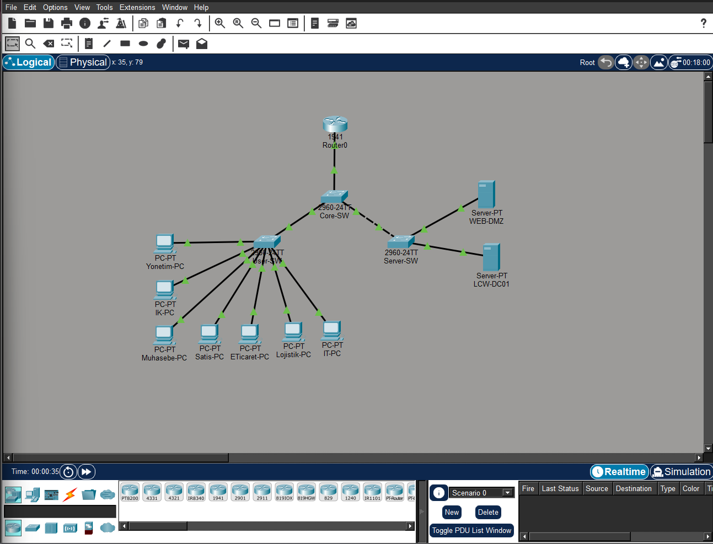

# Enterprise Network & Active Directory Infrastructure Lab

<p align="center"></p>

## 🇹🇷 Türkçe

### Proje Hakkında
Büyük bir perakende ve e-ticaret şirketi senaryosu üzerinden tasarlanmış, ağ segmentasyonu ile merkezi kimlik ve erişim yönetimini bir araya getiren bir kurumsal BT altyapısı projesidir. Ağ katmanı Cisco Packet Tracer'da, sunucu katmanı ise sanal makinede Windows Server 2022 ile kurulmuştur.

> Bu bir akademik vaka çalışmasıdır. Senaryoda adı geçen şirketle herhangi bir bağlantısı yoktur ve şirketin gerçek altyapısını yansıtmaz.

### Özellikler
**Ağ (Cisco Packet Tracer)**
- 9 VLAN: Yönetim, İK, Muhasebe, Satış, E-Ticaret, Lojistik, IT, Sunucular ve DMZ
- Core switch, kullanıcı switch'i ve sunucu switch'i arasında 802.1Q trunk bağlantıları
- Router-on-a-stick ile VLAN'lar arası yönlendirme
- Muhasebe VLAN'ından DMZ'ye erişimi engelleyen genişletilmiş ACL ve ping testleriyle doğrulanması
- Ayrıntılı IP planı

**Sunucu (Windows Server 2022)**
- Active Directory Domain Services ve departman bazlı OU yapısı
- Departman güvenlik grupları ile rol tabanlı erişim (RBAC)
- DHCP kapsamı ve DNS bölgesi yapılandırması
- Departman klasörleri için NTFS izinleri ve SMB paylaşımları
- Grup İlkesi (GPO) ile parola politikası
- Windows Server Backup özelliğinin kurulumu

**Otomasyon:** OU, grup ve kullanıcı oluşturma ile klasör/paylaşım/izin ayarlarını yapan PowerShell betikleri

### Kullanılan Teknolojiler
Cisco Packet Tracer, Cisco IOS, Windows Server 2022, Active Directory, DHCP, DNS, Group Policy, NTFS/SMB, PowerShell, VirtualBox

### Kurulum
```bash
git clone https://github.com/afranurbasak/enterprise-network-ad-infrastructure-lab.git
```
- Ağ topolojisi için [Cisco Packet Tracer](https://www.netacad.com/cisco-packet-tracer) gerekir.
- PowerShell betikleri, Active Directory modülü yüklü bir Windows Server test ortamında yönetici yetkisiyle çalıştırılmalıdır.

### Kullanım
- `packet-tracer/network-topology.pkt` dosyasını Packet Tracer ile açın.
- `configs/` klasöründe router ve switch yapılandırmaları, IP planı, Windows Server kurulum notları ve DHCP/DNS komutları bulunur.
- `scripts/07_AD_PowerShell_Ornek_Script.ps1` OU, güvenlik grubu ve örnek kullanıcı oluşturur. Başlangıç şifresi çalıştırma sırasında sorulur ve kullanıcı ilk girişte şifresini değiştirmek zorundadır.
- `scripts/08_NTFS_FileShare_Ornek_Script.ps1` departman klasörlerini, paylaşımları ve NTFS izinlerini oluşturur.
- Doğrulama ekran görüntüleri [`screenshots/`](screenshots/) klasöründedir.

Yapılandırma notları Türkçedir.

## 🇬🇧 English

### About the Project
An enterprise IT infrastructure project designed around the scenario of a large retail and e-commerce company, combining network segmentation with centralised identity and access management. The network layer was built in Cisco Packet Tracer and the server layer with Windows Server 2022 in a virtual machine.

> This is an academic case study. It has no affiliation with the company named in the scenario and does not reflect that company's real infrastructure.

### Features
**Network (Cisco Packet Tracer)**
- 9 VLANs: Management, HR, Accounting, Sales, E-Commerce, Logistics, IT, Servers and DMZ
- 802.1Q trunk links between the core, user and server switches
- Inter-VLAN routing with router-on-a-stick
- An extended ACL that blocks the Accounting VLAN from reaching the DMZ, verified with ping tests
- Detailed IP addressing plan

**Server (Windows Server 2022)**
- Active Directory Domain Services with a department-based OU structure
- Role-based access control (RBAC) with department security groups
- DHCP scope and DNS zone configuration
- NTFS permissions and SMB shares for department folders
- Password policy via Group Policy (GPO)
- Installing the Windows Server Backup feature

**Automation:** PowerShell scripts that create OUs, groups and users and set up folders, shares and permissions

### Technologies
Cisco Packet Tracer, Cisco IOS, Windows Server 2022, Active Directory, DHCP, DNS, Group Policy, NTFS/SMB, PowerShell, VirtualBox

### Installation
```bash
git clone https://github.com/afranurbasak/enterprise-network-ad-infrastructure-lab.git
```
- The network topology requires [Cisco Packet Tracer](https://www.netacad.com/cisco-packet-tracer).
- Run the PowerShell scripts with administrator rights in a Windows Server test environment with the Active Directory module installed.

### Usage
- Open `packet-tracer/network-topology.pkt` in Packet Tracer.
- `configs/` contains the router and switch configurations, the IP plan, Windows Server setup notes and DHCP/DNS commands.
- `scripts/07_AD_PowerShell_Ornek_Script.ps1` creates OUs, security groups and a sample user. The initial password is requested at run time, and the user must change it at first login.
- `scripts/08_NTFS_FileShare_Ornek_Script.ps1` creates department folders, shares and NTFS permissions.
- Verification screenshots are in [`screenshots/`](screenshots/).

Configuration notes are in Turkish.
